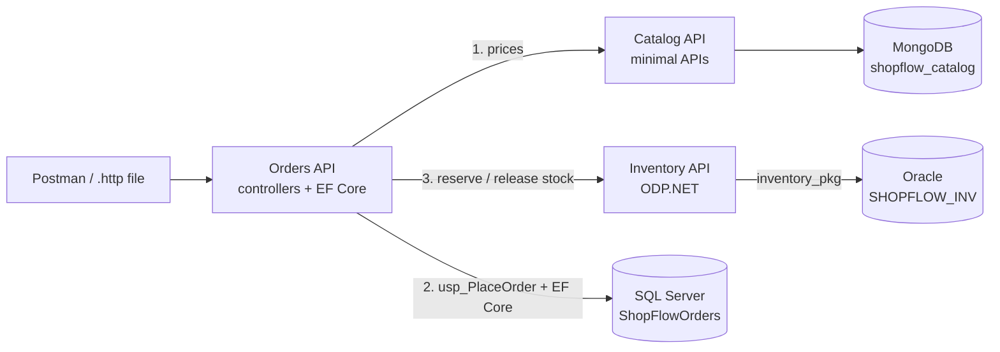

# Interview plan: only the required stack

A 7-day plan (8 hours a day, from Thursday October 29 to Wednesday November 4) for the EvoPoint .NET Developer interview. It covers **only what the job post requires**, and leaves everything listed as *desirable* for after the interview.

| In the plan (required) | Left out for now (desirable) |
| --- | --- |
| .NET Core 6+ (C#, ASP.NET Core Web API) | Azure App Service, Functions, API Management, Logic Apps |
| T-SQL and SQL Server | Docker as a topic, Kubernetes |
| PL/SQL and Oracle | SOA / microservices (Service Bus, events, outbox) |
| Entity Framework Core with SQL Server | Unit and integration testing |
| MongoDB | Git Flow, Continuous Integration |

Two notes:

- **SOLID and design patterns are listed as desirable, but almost every .NET interview asks about them.** The plan keeps a light version of topic 07: the use case and the interfaces the API needs anyway, plus the interview questions. If you want to drop it completely, skip the 2 hours on Day 5.
- You still use Docker containers to **run** the databases; you just don't study Docker as a topic.

---

## What you'll have at the end

The same three databases, connected, but with **direct HTTP calls** instead of events:



1. Orders gets names and prices from **Catalog** (MongoDB).
2. Orders saves the order as `Pending` with `usp_PlaceOrder` in **SQL Server**.
3. Orders asks **Inventory** to reserve stock; Inventory runs `inventory_pkg.reserve_stock` in **Oracle**.
4. Reserved → Orders confirms the order with **EF Core**. Not enough stock → Orders rejects it. If confirming fails after stock was reserved, Orders calls Inventory to **release** it (a compensating action).

That last point gives you a strong interview answer: *"A transaction can't simply span SQL Server and Oracle, so I keep each database consistent on its own and undo the earlier step if a later one fails. With more time I'd move this to events with an outbox."* That's topic 12, for after the interview.

---

## Memory plan for 6 GB of RAM

Run **one heavy database at a time** and stop the others with `docker stop <name>`. In Windows, create `C:\Users\<you>\.wslconfig` with:

```ini
[wsl2]
memory=4GB
swap=4GB
```

Then run `wsl --shutdown` in PowerShell and open Ubuntu again.

| Day | Containers running |
| --- | --- |
| 1–2 | SQL Server |
| 2–3 | Oracle (stop SQL Server first) |
| 3 | MongoDB, started with `--wiredTigerCacheSizeGB 0.25` so it stays small |
| 4 | None (pure C#) |
| 5 | SQL Server |
| 6 | SQL Server, then Oracle |
| 7 | All three for the end-to-end test: MongoDB (small) + SQL Server locally, and **Oracle in the cloud** (Oracle Cloud "Always Free" Autonomous Database), or test the flow in two halves |

Close the browser tabs you don't need while the databases run: Chrome uses a lot.

---

## Day 1 — Thursday Oct 29: setup and SQL Server (T-SQL)

| Time | Do | Where |
| --- | --- | --- |
| 1 h | Repo and solution, **without** Git Flow ceremony: create the GitHub repo, the solution and the projects below, and commit to `main` | [01](topics/01-setup-git-flow.md), Build |
| 2 h | Learn + warm-up: finish the 10 exercises in `practice/shop-practice.sql` | [02](topics/02-sql-server-tsql.md), Learn |
| 4.5 h | Build the Orders database: every task in the main Build section | [02](topics/02-sql-server-tsql.md), Build |
| 0.5 h | Interview questions 1–10 out loud; first draft of "Tell me about yourself" | [Question bank](topics/99-interview-questions.md#02--sql-server-and-t-sql) |

Projects to create on Day 1 (skip the rest of topic 01's table): `ShopFlow.Orders.Domain`, `ShopFlow.Orders.Application`, `ShopFlow.Orders.Infrastructure`, `ShopFlow.Orders.Api`, `ShopFlow.Catalog.Api`, `ShopFlow.Inventory.Api`.

## Day 2 — Friday Oct 30: the rest of T-SQL, then Oracle

| Time | Do | Where |
| --- | --- | --- |
| 3.5 h | The T-SQL extras interviewers ask most: **E1** triggers, **E2** dynamic SQL, **E4** APPLY / PIVOT / recursive calendar, **E5** temp table vs table variable, **E8** isolation levels and a deadlock | [02](topics/02-sql-server-tsql.md), Extra tasks |
| 0.5 h | Extra interview questions of 02 | [Question bank](topics/99-interview-questions.md#02-extras--t-sql) |
| 4 h | Stop SQL Server, start Oracle. Learn PL/SQL, then start the Build: schema, seed, package spec | [03](topics/03-oracle-plsql.md) |

## Day 3 — Saturday Oct 31: finish PL/SQL, MongoDB, start C#

| Time | Do | Where |
| --- | --- | --- |
| 2 h | Finish `inventory_pkg` (body) and the exercises | [03](topics/03-oracle-plsql.md), Build |
| 2.5 h | PL/SQL extras most asked: **X2** collection types (Learn + first two tasks), **X4** dynamic SQL, **X5** autonomous transaction, **X7** mutating table + compound trigger | [03](topics/03-oracle-plsql.md), Extra tasks |
| 0.5 h | Interview questions of 03 and its extras | [Question bank](topics/99-interview-questions.md#03--oracle-and-plsql) |
| 3 h | Stop Oracle, start MongoDB. Learn + all Build tasks | [04](topics/04-mongodb.md) |

## Day 4 — Sunday Nov 1: C# (no databases today)

| Time | Do | Where |
| --- | --- | --- |
| 3.5 h | C# fundamentals and OOP: Learn + `ShopFlow.Orders.Domain` | [05](topics/05-csharp-oop.md) |
| 4 h | Generics, delegates, LINQ, async: parts 1, 2 and 3 fully; part 4 only the `Task.WhenAll` vs sequential comparison | [06](topics/06-generics-linq-async.md) |
| 0.5 h | Interview questions of 05 and 06 | [Question bank](topics/99-interview-questions.md#05--c-fundamentals-and-oop) |

## Day 5 — Monday Nov 2: use cases and Web APIs

| Time | Do | Where |
| --- | --- | --- |
| 2 h | **Light** SOLID and patterns: read Learn; build only the ⭐ tasks (abstractions, ports, `PlaceOrderHandler`, discounts, `AddApplication()`). Skip the decorators and `docs/SOLID.md` | [07](topics/07-solid-design-patterns.md) |
| 5 h | Orders API (controllers) and Catalog API (minimal APIs) with fakes | [08](topics/08-aspnet-core-web-api.md) |
| 1 h | Interview questions of 07 and 08, out loud | [Question bank](topics/99-interview-questions.md#08--aspnet-core-web-api) |

In the `ICatalogClient` port, leave room for a second port you'll add on Day 7: `IInventoryClient`.

## Day 6 — Tuesday Nov 3: EF Core and Oracle from .NET

| Time | Do | Where |
| --- | --- | --- |
| 4.5 h | EF Core with SQL Server: every ⭐ task, plus the concurrency task. Skip the scaffold bonus and the N+1 lab if short on time (but read about N+1: it's always asked) | [09](topics/09-ef-core-sql-server.md) |
| 3 h | Inventory API against Oracle with ODP.NET (Build part 1). **Keep** the `POST /api/reservations` and `DELETE /api/reservations/{orderId}` endpoints: Orders uses them tomorrow | [10](topics/10-oracle-mongodb-dotnet.md), Build part 1 |
| 0.5 h | Interview questions of 09 | [Question bank](topics/99-interview-questions.md#09--ef-core-with-sql-server) |

## Day 7 — Wednesday Nov 4: MongoDB from .NET, connect everything, mock interviews

| Time | Do | Where |
| --- | --- | --- |
| 2 h | Catalog API against MongoDB (Build part 2, ⭐ tasks) | [10](topics/10-oracle-mongodb-dotnet.md), Build part 2 |
| 2.5 h | **Connect the three databases**: the tasks below | This file |
| 1 h | Read only the **Learn** part of topic 11 (security): 401 vs 403, JWT, CORS. Not listed in the post, but asked in most interviews | [11](topics/11-security-jwt.md) |
| 1 h | Skim the **Learn** part of the desirable topics (07 decorators, 12, 13, 14, 16, 17) so you can say *"I know the concept and I'm learning it"* honestly | Topics 12–17 |
| 1.5 h | Mock interview with Claude in English: SQL, PL/SQL, C#, EF Core, MongoDB and "walk me through your project" | [Question bank](topics/99-interview-questions.md) |

### Connect the three databases (synchronous version)

This replaces topic 12 for the interview. Topic 12 builds the event-driven version later.

**Ports in `ShopFlow.Orders.Application`**
- `ICatalogClient` (already exists).
- New `IInventoryClient` with `ReserveAsync(orderId, lines, ct)` returning a result record (`Status`: `Reserved`, `AlreadyReserved` or `Failed`, plus `Message`) and `ReleaseAsync(orderId, ct)`.

**Implementations in `ShopFlow.Orders.Infrastructure`**
- [ ] `CatalogClient`: a typed `HttpClient` that calls `GET /api/products/lookup?skus=…` on Catalog. Base URL from `Catalog:BaseUrl`; timeout of 5 seconds. Delete the fake.
- [ ] `InventoryClient`: a typed `HttpClient` that calls `POST /api/reservations` and `DELETE /api/reservations/{orderId}` on Inventory. Base URL from a new `Inventory:BaseUrl` setting (`http://localhost:5103`); timeout of 5 seconds.

**New flow in `PlaceOrderHandler`**
1. Validate, get prices from Catalog, build the `Order` (as before).
2. Save it as `Pending` with `usp_PlaceOrder` and get its Id.
3. Call `IInventoryClient.ReserveAsync`.
4. `Reserved` or `AlreadyReserved` → load the order, `Confirm()`, `SaveChangesAsync` → return the Id (201).
   - If that save fails, call `ReleaseAsync` (the **compensation**), then let the error continue.
5. `Failed` → `Reject(message)`, save → return a `Conflict` with code `order.out_of_stock` and the order Id (409).
6. Inventory unreachable (timeout, connection refused, 5xx) → leave the order `Pending` and return `Failure` with code `inventory.unavailable` (503). Write a comment: who would fix this order, and how events (topic 12) would fix it automatically.

**Cancel**
- [ ] After `CancelOrderHandler` saves the cancellation, call `ReleaseAsync`. If Inventory is down, log a warning with the order Id: the stock stays reserved until someone releases it. Write in a comment why this is the weak point of synchronous calls.

**Write your decisions**
- [ ] In `docs/DECISIONS.md`, 5–6 lines in English: why no transaction across SQL Server and Oracle, how the compensation works, what happens when a service is down, and what you'd change with events and an outbox. **Read it out loud before the interview.**

**Check**
- [ ] Order with available SKUs → 201; `GET` shows `Confirmed`; Oracle has `ACTIVE` reservations.
- [ ] Order with `UPS-APC-1500` → 409 `order.out_of_stock`; the order exists as `Rejected`; Oracle's `reserved` didn't change.
- [ ] Inventory stopped → 503 `inventory.unavailable`; the order stays `Pending`.
- [ ] Cancel a confirmed order → `Cancelled`; Oracle reservations `RELEASED`.

---

## The day before the interview

- Two full mock interviews (technical + "walk me through your project"), recorded, and listen back.
- Your 60–90 second "Tell me about yourself" and the 2-minute project walkthrough, without notes.
- Re-read: the question bank sections for 02, 03, 04, 05, 06, 08, 09 and 10, plus `docs/DECISIONS.md`.
- Push everything to GitHub with a short README, so you can share the link if they ask.
- Stop studying early and sleep.

## After the interview

Continue with the full roadmap in the [README](README.md): topics 11–18 and the extras you skipped. The project grows into the event-driven version, and everything you built this week stays.
