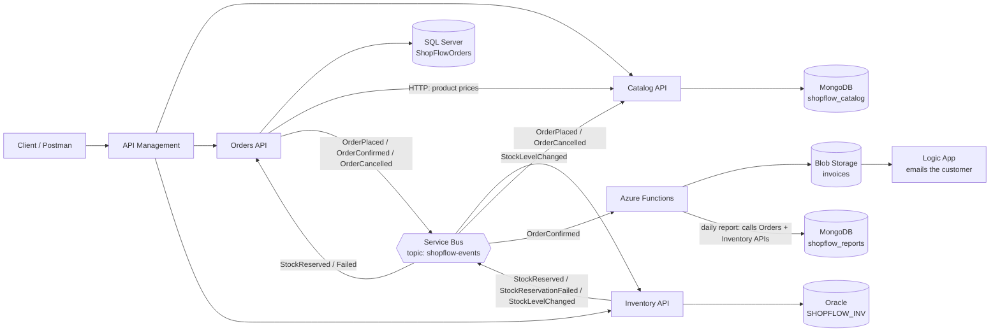

# ShopFlow Study Guide

Learn every topic in the .NET Developer job post by building **one real backend, step by step**. Each topic teaches a skill, then you add that skill to the same project. By the end, ShopFlow uses SQL Server, Oracle and MongoDB together, talks through events on Azure Service Bus, runs in Docker and Kubernetes, and deploys to Azure.

> **Interview this week?** Start with [INTERVIEW-PLAN.md](INTERVIEW-PLAN.md).

> **You write all the code.** This guide gives you the plan, the structure (skeleton), the tasks, hints and acceptance criteria — not the solutions. When you get stuck, paste your code to Claude and ask for a hint or a review against the topic's acceptance criteria.

## What's in this guide

```text
ShopFlow-Study-Guide/
├── README.md                     this file: the project, the roadmap and the rules
├── INTERVIEW-PLAN.md             7-day plan with only the required stack
├── topics/01-…18-*.md            one file per topic, in order
├── topics/99-interview-questions.md   every question with a model answer
└── practice/shop-practice.sql    warm-up SQL exercises (before topic 02)
```

Copy this folder into your ShopFlow repository as `docs/study-guide/` so the guide and your code live together.

---

## How each topic file works

Every file in `topics/` has the same parts:

| Part | What you do |
| --- | --- |
| **Why it matters** | Understand where the topic shows up in the job and in interviews |
| **Learn** | Concepts and small examples, not about ShopFlow |
| **Build** | Add that topic's piece to ShopFlow: files to create, tasks, hints, acceptance criteria |
| **Check yourself** | Commands and tests that prove your piece works |
| **Interview questions** | Practice answering out loud, in English |
| **Done when** | The checklist before you open your pull request |

Every topic is one Git branch (`feature/NN-topic-name`) and one pull request into `develop`. That way you practice Git Flow from day one.

---

## The project: ShopFlow

ShopFlow is the backend of an online store with three services. **Each service owns one database, and no service ever reads another service's database.** Services share data in two ways: HTTP calls when they need an answer right now, and events on a message bus when something happened.

| Service | Database | Why this database | API style |
| --- | --- | --- | --- |
| **Catalog** | MongoDB `shopflow_catalog` | Products have different attributes (a laptop has RAM, a chair has material): flexible documents fit | Minimal APIs |
| **Orders** | SQL Server `ShopFlowOrders` | Orders and payments need strong transactions and relations | Controllers + Clean Architecture |
| **Inventory** | Oracle schema `SHOPFLOW_INV` | Stock is often managed in an Oracle ERP in real companies; PL/SQL packages hold the stock rules | Controllers |
| **Functions** | Blob Storage + MongoDB `shopflow_reports` | Background work: invoices and daily reports | Azure Functions (isolated worker) |

### Architecture



### How an order flows through all three databases

1. The client sends `POST /api/orders` to the **Orders API**.
2. Orders asks the **Catalog API** for the current price of each product (HTTP, with retries and a circuit breaker).
3. Orders runs the stored procedure `usp_PlaceOrder` in **SQL Server** (through EF Core). In one transaction it saves the order as `Pending` and writes an `OrderPlaced` message to the `OutboxMessages` table.
4. A background publisher reads the outbox and sends `OrderPlaced` to **Service Bus**.
5. The **Inventory API** receives `OrderPlaced` and calls the PL/SQL package `inventory_pkg.reserve_stock` in **Oracle**. Then it publishes `StockReserved` or `StockReservationFailed`, plus one `StockLevelChanged` per product.
6. Orders receives the answer, loads the order with **EF Core** and calls `Confirm()` or `Reject()`. In the same `SaveChanges` transaction, a confirmed order writes `OrderConfirmed` to the outbox.
7. **Catalog** receives `StockLevelChanged` and updates the product's availability in **MongoDB**.
8. The **GenerateInvoice** function receives `OrderConfirmed` and saves an invoice in **Blob Storage**. A **Logic App** emails it to the customer.
9. Every morning, the **DailySalesReport** function calls the Orders API (sales, from a SQL Server procedure) and the Inventory API (low stock, from an Oracle package), and saves one report document in its own MongoDB database, `shopflow_reports`.
10. If a customer cancels a `Pending` or `Confirmed` order, Orders publishes `OrderCancelled` and Inventory releases the reservation.

This is a **saga by choreography**: there is no central coordinator, and each service reacts to events. Rejecting an order when stock fails, and releasing stock when an order is cancelled, are the compensating actions.

Notice that the order uses **both** ways of writing to SQL Server: a stored procedure for the heavy, all-or-nothing insert, and EF Core for changing one aggregate. That's the answer to a classic interview question: *"When do you use EF Core and when a stored procedure?"*

### Events

| Event | Published by | Received by | Data |
| --- | --- | --- | --- |
| `OrderPlaced` | Orders | Inventory | OrderId, CustomerId, Items (Sku, Quantity), OccurredAt |
| `StockReserved` | Inventory | Orders | OrderId |
| `StockReservationFailed` | Inventory | Orders | OrderId, Reason |
| `StockLevelChanged` | Inventory | Catalog | Sku, Available |
| `OrderConfirmed` | Orders | Functions | OrderId, CustomerEmail, Total, Items |
| `OrderCancelled` | Orders | Inventory | OrderId, Reason |

Every event also carries `EventId` (a GUID used for idempotency) and `OccurredAt`.

### Shared product list

The three databases describe the **same products from different angles**, linked by the SKU. Catalog (MongoDB) is the source of truth for names and prices. Orders (SQL Server) copies the price at the moment of the order. Inventory (Oracle) only knows quantities. Use exactly these SKUs in every seed script.

| SKU | Product | Category | Price (DOP) |
| --- | --- | --- | --- |
| `LAP-DELL-5440` | Dell Latitude 5440 laptop | Laptops | 55,000.00 |
| `MON-LG-24` | LG 24-inch monitor | Monitors | 9,500.00 |
| `MOU-LOGI-M185` | Logitech M185 wireless mouse | Accessories | 850.00 |
| `KEY-MECH-RED` | Mechanical keyboard, red switches | Accessories | 3,200.00 |
| `CHR-ERGO-01` | Ergonomic office chair | Furniture | 12,500.00 |
| `DSK-STAND-01` | Standing desk | Furniture | 24,000.00 |
| `PRN-HP-M404` | HP LaserJet M404 printer | Printers | 18,000.00 |
| `HUB-USBC-7` | 7-in-1 USB-C hub | Accessories | 1,900.00 |
| `RTR-TPL-AX55` | TP-Link AX55 Wi-Fi 6 router | Networking | 6,500.00 |
| `UPS-APC-1500` | APC 1500VA UPS | Power | 11,000.00 |

---

## Roadmap

| # | Topic | What you add to ShopFlow | Job requirement | Time |
| --- | --- | --- | --- | --- |
| 01 | [Setup, Git and Git Flow](topics/01-setup-git-flow.md) | Repository, solution skeleton, branches | Git Flow | 2 h |
| 02 | [SQL Server and T-SQL](topics/02-sql-server-tsql.md) | Orders database: tables, seed, procedures, views, indexes (+ extras: triggers, dynamic SQL, JSON, APPLY, PIVOT, isolation, security) | T-SQL, SQL Server | 6 h (+4 h extras) |
| 03 | [Oracle and PL/SQL](topics/03-oracle-plsql.md) | Inventory database: tables, `inventory_pkg` (+ extras: collections, pipelined functions, dynamic SQL, autonomous transactions, compound triggers, materialized views, jobs) | PL/SQL, Oracle | 5 h (+4–5 h extras) |
| 04 | [MongoDB](topics/04-mongodb.md) | Catalog database: collections, indexes, aggregation | MongoDB | 3 h |
| 05 | [C# fundamentals and OOP](topics/05-csharp-oop.md) | `Orders.Domain`: entities, value objects, business rules | .NET Core | 4 h |
| 06 | [Generics, delegates, LINQ and async](topics/06-generics-linq-async.md) | `Result<T>`, domain events, LINQ reports | .NET Core | 4 h |
| 07 | [SOLID and design patterns](topics/07-solid-design-patterns.md) | `Orders.Application`: use cases, interfaces, Strategy, Factory | SOLID, design patterns | 4 h |
| 08 | [ASP.NET Core Web API](topics/08-aspnet-core-web-api.md) | `Orders.Api` (controllers), `Catalog.Api` (minimal APIs) | .NET Core 6+ | 5 h |
| 09 | [EF Core with SQL Server](topics/09-ef-core-sql-server.md) | `Orders.Infrastructure`: DbContext, repositories, procedures, Dapper | Entity Framework Core | 5 h |
| 10 | [Oracle and MongoDB from .NET](topics/10-oracle-mongodb-dotnet.md) | `Inventory.Api` with ODP.NET, `Catalog.Api` with MongoDB | Oracle, MongoDB | 5 h |
| 11 | [Security: JWT, policies, CORS](topics/11-security-jwt.md) | Authentication and authorization in all three APIs | Always asked | 3 h |
| 12 | [SOA and microservices](topics/12-soa-microservices.md) | Events, Service Bus, outbox, saga, resilience | SOA / Microservices | 6 h |
| 13 | [Unit and integration testing](topics/13-testing.md) | Unit tests + integration tests against all three databases | Unit / Integration Testing | 5 h |
| 14 | [Docker and Docker Compose](topics/14-docker.md) | Dockerfiles + one compose file for the whole system | Docker | 3 h |
| 15 | [Continuous Integration](topics/15-continuous-integration.md) | Azure Pipelines: build, test, images | CI, Git Flow | 2 h |
| 16 | [Azure Functions](topics/16-azure-functions.md) | `GenerateInvoice` and `DailySalesReport` | Azure Functions | 4 h |
| 17 | [App Service, API Management, Logic Apps](topics/17-azure-app-service-apim-logic-apps.md) | Deploy to Azure, gateway, email workflow | App Services, APIM, Logic Apps | 5 h |
| 18 | [Kubernetes](topics/18-kubernetes.md) | Manifests, probes and scaling on a local cluster | Kubernetes | 3 h |
| — | [Interview question bank](topics/99-interview-questions.md) | — | All | ongoing |

**Total: about 74 hours, plus about 9 hours of optional SQL extras** that cover the rest of T-SQL and PL/SQL. At 5–6 hours a day, that's about 2–3 weeks.

---

## Interview mode

Interview in about a week? Follow **[INTERVIEW-PLAN.md](INTERVIEW-PLAN.md)**: 7 days at 8 hours a day with only the stack the job **requires** (C#, ASP.NET Core, T-SQL, PL/SQL, SQL Server, Oracle, EF Core, MongoDB), the three databases connected with direct HTTP calls, and a memory plan for a 6 GB machine. Everything the job lists as desirable waits until after the interview.

---

## Repository skeleton

This is the final shape of your repository. You create each part in the topic shown in brackets.

```text
ShopFlow/
├── README.md                                   [01] your own project README
├── ShopFlow.sln                                [01]
├── .gitignore  .editorconfig                   [01]
├── database/
│   ├── sqlserver/                              [02] 01_schema.sql … 06_indexes.sql
│   ├── oracle/                                 [03] 01_schema.sql … 04_inventory_pkg_body.sql
│   └── mongo/                                  [04] 01_catalog.js, 02_indexes.js
├── src/
│   ├── BuildingBlocks/
│   │   ├── ShopFlow.Contracts/                 [01][12] event records shared by all services
│   │   ├── ShopFlow.Messaging/                 [12] IEventBus + Service Bus implementation
│   │   └── ShopFlow.ServiceDefaults/           [11] auth, errors, health checks, telemetry shared by the APIs
│   ├── Orders/
│   │   ├── ShopFlow.Orders.Domain/             [05][06]
│   │   ├── ShopFlow.Orders.Application/        [07]
│   │   ├── ShopFlow.Orders.Infrastructure/     [09][12]
│   │   └── ShopFlow.Orders.Api/                [08][11]
│   ├── Catalog/ShopFlow.Catalog.Api/           [08][10]
│   ├── Inventory/ShopFlow.Inventory.Api/       [10]
│   └── Functions/ShopFlow.Functions/           [16]
├── tools/
│   └── ShopFlow.Playground/                    [06] console app for experiments
├── tests/
│   ├── ShopFlow.Orders.UnitTests/              [13]
│   ├── ShopFlow.Orders.IntegrationTests/       [13]
│   ├── ShopFlow.Catalog.IntegrationTests/      [13]
│   └── ShopFlow.Inventory.IntegrationTests/    [13]
├── deploy/
│   ├── docker-compose.yml                      [14]
│   ├── servicebus/Config.json                  [12]
│   ├── k8s/                                    [18]
│   └── azure/                                  [17] APIM policy, notes
├── azure-pipelines.yml                         [15]
└── docs/
    └── study-guide/                            put this guide here
```

Orders uses full Clean Architecture (four projects) because it holds the most business rules. Catalog and Inventory are small, so each is one API project with folders. That's a deliberate choice you can explain in an interview: **don't over-engineer small services.**

---

## Local names and ports

Use these everywhere so the topics connect without surprises.

| Component | Local address | Name |
| --- | --- | --- |
| Catalog.Api | `http://localhost:5101` | — |
| Orders.Api | `http://localhost:5102` | — |
| Inventory.Api | `http://localhost:5103` | — |
| SQL Server | `localhost,1433` | database `ShopFlowOrders` |
| Oracle | `localhost:1521/FREEPDB1` | user `shopflow_inv` |
| MongoDB | `localhost:27017` | database `shopflow_catalog` |
| Service Bus emulator | `localhost:5672` | topic `shopflow-events` |
| Azurite (Storage emulator) | `localhost:10000` (Blob) | container `invoices` |
| MongoDB (reports) | `localhost:27017` | database `shopflow_reports` |

### Configuration keys

Use the same names in user secrets, Docker Compose, Kubernetes and Azure, so a setting never gets lost between topics.

| Key | Used by | Example value (local) |
| --- | --- | --- |
| `ConnectionStrings:OrdersDb` | Orders | `Server=localhost,1433;Database=ShopFlowOrders;User Id=sa;Password=…;TrustServerCertificate=True` |
| `ConnectionStrings:InventoryDb` | Inventory | `User Id=shopflow_inv;Password=…;Data Source=localhost:1521/FREEPDB1` |
| `ConnectionStrings:CatalogDb` + `CatalogMongo:Database` | Catalog | `mongodb://localhost:27017` + `shopflow_catalog` |
| `ConnectionStrings:ServiceBus` | All services | Emulator connection string with `UseDevelopmentEmulator=true` |
| `Catalog:BaseUrl` | Orders | `http://localhost:5101` |
| `Jwt:Issuer`, `Jwt:Audience`, `Jwt:SigningKey` | All APIs | `shopflow-dev`, `shopflow-api`, 32+ random characters |
| `Database:MigrateOnStartup` | Orders | `true` in Compose, `false` in Azure |

In environment variables, `:` becomes `__` (`ConnectionStrings__OrdersDb`).

---

## What you need

- **.NET 10 SDK** (LTS, supported until November 2028).
- **VS Code** with: C# Dev Kit, SQL Server (mssql), Oracle SQL Developer, MongoDB for VS Code, Docker, REST Client (for `.http` files).
- **Docker Desktop.** Running everything at once needs a lot of memory; give Docker at least 8 GB and start only the containers the current topic needs.
- **Git** and a **GitHub** account (the repo is your portfolio).
- **Azure account** (topic 17). Put everything in one resource group and delete it after you practice.

---

## Rules for the whole project

1. **Git Flow:** create `develop` in topic 01. Each topic = `feature/NN-short-name` → pull request into `develop`. After topic 18, create `release/1.0.0`, merge it into `main` and tag `v1.0.0`.
2. **Commit messages:** `feat:`, `fix:`, `test:`, `docs:`, `refactor:`, `chore:` (Conventional Commits).
3. **Type the code, don't paste it.** Typing is how it sticks.
4. **Explain as you go:** in each pull request description, write 3–5 lines in English about what you built and why. That's interview practice for free.
5. **Ask for review:** paste your code to Claude with "review this against topic NN acceptance criteria" to get feedback without getting the answer.
