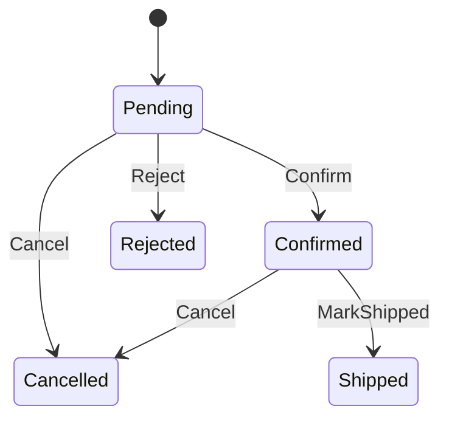

# 05 — C# fundamentals and OOP

> **Time:** 4 h · **Job requirement:** .NET Core 6+ · **Builds on:** 01 · **Branch:** `feature/05-orders-domain`

## Why it matters

Almost every .NET interview opens with C# and OOP: value vs reference types, abstract class vs interface, encapsulation. In ShopFlow you apply all of it in `ShopFlow.Orders.Domain`: the business rules of an order, written in plain C# with **no** database or web code.

---

## Learn

### Types

| Kind | Examples | Assigning copies… | Lives |
| --- | --- | --- | --- |
| Value type | `int`, `decimal`, `bool`, `DateTime`, `struct`, `enum`, `record struct` | the value | Inline (stack or inside its owner) |
| Reference type | `class`, `string`, arrays, `record`, delegates | the reference | Heap |

- **Boxing:** converting a value type to `object` allocates on the heap. Generics avoid it (topic 06).
- **`string` is immutable:** every change creates a new string; use `StringBuilder` in loops.
- **Nullable reference types:** `string?` may be null; `string` should not. With `<Nullable>enable</Nullable>` the compiler warns you (and in ShopFlow, warnings are errors).

### class, struct, record

```csharp
public class Car { public string Plate { get; set; } = ""; }     // reference, identity equality
public struct Point { public int X; public int Y; }               // value, copied on assignment
public record Address(string Street, string City);                // reference, VALUE equality, immutable
public readonly record struct Temperature(decimal Celsius);       // value type with value equality

var a = new Address("Calle 1", "Santiago");
var b = a with { City = "La Romana" };      // non-destructive copy
Console.WriteLine(a == new Address("Calle 1", "Santiago"));   // True
```

Use **records for value objects** (things defined by their values: money, an email) and **classes for entities** (things with an identity that lasts: an order, a customer).

### Encapsulation

```csharp
public class BankAccount
{
    private readonly List<decimal> _movements = [];

    public BankAccount(string owner) => Owner = owner;           // constructor

    public string Owner { get; }                                  // read-only property
    public decimal Balance { get; private set; }                  // only this class can change it
    public IReadOnlyCollection<decimal> Movements => _movements.AsReadOnly();

    public void Withdraw(decimal amount)
    {
        if (amount <= 0) throw new ArgumentOutOfRangeException(nameof(amount));
        if (amount > Balance) throw new InvalidOperationException("Insufficient funds.");
        Balance -= amount;
        _movements.Add(-amount);
    }
}
```

The rule: **objects protect their own invariants.** Nobody outside can set `Balance` to a wrong value or add to the list directly.

### The four pillars

| Pillar | In one sentence | C# tools |
| --- | --- | --- |
| Encapsulation | Hide state; change it only through methods that enforce rules | `private`, `private set`, `readonly`, `IReadOnlyCollection` |
| Abstraction | Expose what an object does, not how | interfaces, abstract classes |
| Inheritance | Reuse and extend a base class | `class Dog : Animal` (one base class only) |
| Polymorphism | Same call, behavior depends on the real type | `virtual`/`override`, interfaces, overloading |

### Abstract class vs interface

| | Abstract class | Interface |
| --- | --- | --- |
| How many per class | One | Many |
| Fields / constructors | Yes | No instance fields, no constructors |
| Code | Abstract and normal members | Contract; default implementations allowed |
| Use for | Related types sharing code ("is a") | A capability or a contract you can mock ("can do") |

`virtual` = may be overridden · `abstract` = must be overridden · `override` = replaces it · `sealed` = no more overriding or inheriting · `new` = hides a member (not polymorphic, avoid).

### Pattern matching and switch expressions

```csharp
string Describe(object value) => value switch
{
    null                    => "nothing",
    int n when n < 0        => "negative number",
    int                     => "number",
    string { Length: 0 }    => "empty text",
    string s                => $"text: {s}",
    Address { City: "Santiago" } => "someone in Santiago",
    _                       => "something else"
};
```

### Exceptions

Throw the most specific exception that fits; create your own when callers need to recognize a business error:

```csharp
public sealed class ReservationException(string code, string message) : Exception(message)
{
    public string Code { get; } = code;
}
```

Use exceptions for **broken rules or unexpected failures**, not for normal flow (topic 06 adds `Result<T>` for expected failures).

### Equality

- Classes: `==` compares references unless you override `Equals`, `GetHashCode` and the operators.
- Records and record structs: compare all their values automatically.
- Entities are equal when they're the same type with the same Id, not when all fields match.

---

## Build: `ShopFlow.Orders.Domain`

This project references **nothing**: no EF Core, no ASP.NET Core. If you feel the need for a NuGet package here, stop and rethink.

### Folder layout

```text
ShopFlow.Orders.Domain/
├── Common/        Entity.cs, DomainException.cs
├── ValueObjects/  Money.cs, Sku.cs, Email.cs
├── Customers/     Customer.cs
└── Orders/        Order.cs, OrderItem.cs, OrderStatus.cs
```

### Specification

**`Entity`** (abstract class): `int Id` with a protected setter; two entities are equal when they have the same runtime type and the same non-zero Id. Override `Equals`, `GetHashCode`, `==` and `!=`.

**`DomainException`** (sealed): carries a `Code` string such as `"order.invalid_transition"` plus the message.

**`Money`** (readonly record struct): `Amount` (`decimal`), `Currency` (3 uppercase letters).
- Throws if the amount is negative or the currency isn't 3 letters.
- `static Money Zero(string currency)`, operators `+` and `-` (only with the same currency, otherwise throw), `Money * int`.
- `ToString()` → `"DOP 1,700.00"`.

**`Sku`** (sealed record): one `Value` string. `static Sku Create(string value)` trims, upper-cases and validates with the pattern `^[A-Z]{3}-[A-Z0-9]+(-[A-Z0-9]+)*$`; invalid → `DomainException("sku.invalid", …)`. The constructor is private.

**`Email`** (sealed record): same idea as `Sku`, with a simple email check and lower-case value.

**`OrderStatus`** (enum): `Pending`, `Confirmed`, `Rejected`, `Cancelled`, `Shipped`.

**`Customer`** (entity): `FullName`, `Email` (`Email`), `City`, `CreatedAt`. Static `Create(...)` validates that the name and city aren't empty.

**`OrderItem`** (entity, only created by `Order`): `Sku`, `ProductName`, `Quantity`, `UnitPrice` (`Money`), and a computed `LineTotal`. Quantity must stay > 0.

**`Order`** (entity, the aggregate root):

| Member | Rule |
| --- | --- |
| `CustomerId`, `Status`, `CreatedAt`, `ConfirmedAt?`, `CancelledAt?`, `StatusReason?` | Private setters |
| `Items` | `IReadOnlyCollection<OrderItem>` backed by a private list |
| `Subtotal`, `Discount`, `Total` | `Money`; `Total = Subtotal - Discount`; recalculated whenever items or discount change |
| `static Order Create(int customerId, DateTime utcNow)` | New order, `Pending`, zero totals |
| `AddItem(Sku sku, string productName, int quantity, Money unitPrice)` | Only while `Pending`; adding an existing SKU increases its quantity instead of a second line; all lines must use the same currency |
| `ApplyDiscount(Money discount)` | Only while `Pending`; can't be greater than the subtotal |
| `Confirm(DateTime utcNow)` | `Pending → Confirmed`; sets `ConfirmedAt` |
| `Reject(string reason)` | `Pending → Rejected`; reason required |
| `Cancel(string reason, DateTime utcNow)` | `Pending` or `Confirmed → Cancelled` |
| `MarkShipped()` | `Confirmed → Shipped` |
| Any other transition | `DomainException("order.invalid_transition", "Cannot … an order that is …")` |
| An order with no items | Can't be confirmed (`"order.empty"`) |

Allowed transitions:



### Tasks

- [ ] ⭐ Write `Entity`, `DomainException`, `Money`, `Sku` and `Email`.
- [ ] ⭐ Write `OrderStatus`, `OrderItem` and `Order` with every rule in the table.
  - Hint: put the transition check in one private method, e.g. `EnsureStatus(OrderStatus expected, string action)`, or use a switch expression on `(Status, action)`. Don't repeat `if` blocks in every method.
  - Hint: EF Core (topic 09) needs a parameterless constructor; add a `private Order() { }` now so you don't have to open the class up later.
- [ ] Write `Customer`.
- [ ] ⭐ Make the build fail if anything outside the Domain can change an order's state without going through a method. Try it: from another project, `order.Status = OrderStatus.Shipped;` must not compile.
- [ ] Add XML doc comments (`/// <summary>`) to `Order`'s public methods explaining the rule each one enforces.

---

## Check yourself

Use a C# 14 file-based app, no project needed. Create `scratch/domain-check.cs`:

```csharp
#:project ../src/Orders/ShopFlow.Orders.Domain/ShopFlow.Orders.Domain.csproj
using ShopFlow.Orders.Domain.Orders;
// ...create an order, add two lines (one SKU twice), confirm it, then try to confirm it again
```

Run it with `dotnet run scratch/domain-check.cs`. Check that:
- Adding the same SKU twice gives one line with the summed quantity.
- `Total` equals `Subtotal - Discount` after every change.
- Confirming twice throws `DomainException` with code `order.invalid_transition`.
- `Money(10, "DOP") + Money(5, "USD")` throws.
- `Sku.Create(" mon-lg-24 ")` gives `MON-LG-24`; `Sku.Create("bad sku")` throws.

These become real unit tests in topic 13. Don't commit the `scratch` folder: add it to `.gitignore`.

---

## Interview questions

1. Value type vs reference type? What is boxing?
2. class vs struct vs record: when do you use each?
3. Explain the four pillars of OOP with an example from your code.
4. Abstract class vs interface?
5. `virtual`, `abstract`, `override`, `sealed`, `new`: what does each do?
6. How do you protect an object's invariants?
7. Why expose `IReadOnlyCollection<T>` instead of `List<T>`?
8. Entity vs value object?

Answers: [interview question bank](99-interview-questions.md#05--c-fundamentals-and-oop).

---

## Done when

- [ ] The Domain project has zero package and project references.
- [ ] Every rule in the specification table is enforced, and the scratch checks pass.
- [ ] Pull request into `develop` merged.
