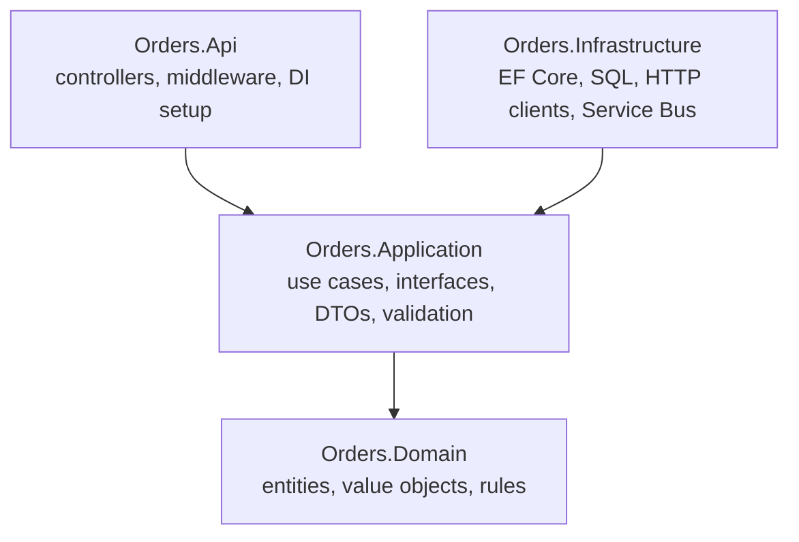

# 07 — SOLID and design patterns

> **Time:** 4 h · **Job requirement:** SOLID principles, software design patterns · **Builds on:** 05, 06 · **Branch:** `feature/07-orders-application`

## Why it matters

The job lists SOLID and design patterns as desired practices, and interviewers rarely accept a memorized definition: they ask *"show me where you used it"*. After this topic you'll point to real classes in ShopFlow for every letter of SOLID and for six patterns.

In ShopFlow this is `ShopFlow.Orders.Application`: the **use cases** (place, confirm, reject, cancel an order) written against interfaces, so they don't know whether data comes from SQL Server, a fake list or a test.

---

## Learn

### SOLID

| Letter | Principle | Smell that breaks it | Fix |
| --- | --- | --- | --- |
| **S** | Single Responsibility: one reason to change | A service that validates, calculates, saves and emails | Split into classes with one job each |
| **O** | Open/Closed: add behavior without editing existing code | A growing `switch` on a type | Strategy, decorators, new classes |
| **L** | Liskov Substitution: a subtype works wherever its base type works | An override that throws `NotSupportedException` | Separate the capability into its own interface |
| **I** | Interface Segregation: small, focused interfaces | `IRepository` with 20 methods that most callers don't use | Split by what each client needs |
| **D** | Dependency Inversion: depend on abstractions; the details depend on them too | `new SqlConnection(...)` inside business code | Interfaces in the inner layer, implementations outside, constructor injection |

*Dependency Inversion* is the principle; *Dependency Injection* is the technique that applies it. Interviewers like that distinction.

### Clean Architecture



Dependencies point **inward**. Application defines `IOrderRepository`; Infrastructure implements it. The use cases never mention EF Core, so you can swap the database or test them with fakes.

### Patterns you'll use (and where .NET already uses them)

| Pattern | Problem it solves | Example in .NET |
| --- | --- | --- |
| Repository | Hide data access behind a collection-like interface | `DbSet<T>` already behaves like one |
| Unit of Work | Commit many changes in one transaction | `DbContext.SaveChangesAsync` |
| Strategy | Choose an algorithm at runtime | `IComparer<T>`, authentication schemes |
| Factory | Create objects without the caller knowing the concrete type | `IHttpClientFactory`, `ILoggerFactory` |
| Decorator | Add behavior by wrapping an object with the same interface | `BufferedStream` wrapping a `Stream` |
| Command / CQRS | Separate writes (commands) from reads (queries), one handler each | MediatR-style handlers |
| Options | Strongly typed configuration | `IOptions<T>` |
| Observer | Notify subscribers | C# events, `IObservable<T>` |
| Singleton | One instance for the app | `AddSingleton<T>()` |

```csharp
// Decorator: same interface, adds behavior, delegates the real work
public sealed class TimingNotifier(INotifier inner, ILogger<TimingNotifier> log) : INotifier
{
    public async Task SendAsync(string message, CancellationToken ct)
    {
        var sw = Stopwatch.StartNew();
        await inner.SendAsync(message, ct);
        log.LogInformation("Sent in {Ms} ms", sw.ElapsedMilliseconds);
    }
}
```

**Do you need MediatR?** Many projects use it for commands and queries. It now has a commercial license for many companies, so plenty of teams write the two small interfaces themselves. That's what you'll do here: it's less magic and easier to explain.

---

## Build: `ShopFlow.Orders.Application`

### Folder layout

```text
ShopFlow.Orders.Application/
├── Common/            Result, Error, PagedResult (from topic 06)
├── Abstractions/      ICommand, ICommandHandler, IQuery, IQueryHandler, IUnitOfWork
├── Orders/
│   ├── PlaceOrder/    PlaceOrderCommand, PlaceOrderHandler, PlaceOrderValidator
│   ├── ConfirmOrder/  RejectOrder/  CancelOrder/
│   ├── GetOrderById/  GetCustomerOrders/  GetSalesReport/
│   ├── Dtos/          OrderDetailsDto, OrderSummaryDto, SalesReportDto
│   └── IOrderRepository.cs, IOrderReadService.cs
├── Customers/         ICustomerRepository.cs
├── Catalog/           ICatalogClient.cs, CatalogProduct.cs
├── Discounts/         IDiscountPolicy, NoDiscount, FirstOrderDiscount, VolumeDiscount, DiscountPolicyFactory
├── Behaviors/         ValidationDecorator, LoggingDecorator
└── DependencyInjection.cs   AddApplication()
```

Packages allowed here: `FluentValidation`, `Microsoft.Extensions.Logging.Abstractions`, `Microsoft.Extensions.DependencyInjection.Abstractions`. Nothing about EF Core, SQL or HTTP.

### Contracts

**Handlers**

```csharp
public interface ICommand<TResult>;
public interface ICommandHandler<in TCommand, TResult> where TCommand : ICommand<TResult>
{
    Task<TResult> HandleAsync(TCommand command, CancellationToken ct);
}
// IQuery<TResult> and IQueryHandler<TQuery, TResult>: same shape
```

**Ports** (implemented in topics 09 and 12):

| Interface | Methods (you choose exact signatures) |
| --- | --- |
| `IOrderRepository` | Get an order by Id **with its items** for changes; place a new order (topic 09 runs `usp_PlaceOrder`) and return its Id |
| `IOrderReadService` | Order details DTO by Id; a page of a customer's orders; the sales report |
| `ICustomerRepository` | Does a customer exist; does a customer have previous orders |
| `IUnitOfWork` | `SaveChangesAsync` |
| `ICatalogClient` | Get `CatalogProduct(Sku, Name, Price, IsActive)` for a list of SKUs |

Notice the split: `IOrderRepository` returns **domain objects** for writing; `IOrderReadService` returns **DTOs** for reading. That's CQRS at its simplest. Explain why reads don't need the domain model.

**Use cases**

| Command / query | Returns | Rules |
| --- | --- | --- |
| `PlaceOrderCommand(CustomerId, Lines[Sku, Quantity])` | `Result<int>` (new order Id) | See below |
| `ConfirmOrderCommand(OrderId)` | `Result` | Not found → `NotFound`; invalid transition → `Conflict` |
| `RejectOrderCommand(OrderId, Reason)` | `Result` | Same |
| `CancelOrderCommand(OrderId, Reason)` | `Result` | Same |
| `GetOrderByIdQuery(OrderId)` | `Result<OrderDetailsDto>` | Not found → `NotFound` |
| `GetCustomerOrdersQuery(CustomerId, Page, PageSize)` | `Result<PagedResult<OrderSummaryDto>>` | `PageSize` max 50 |
| `GetSalesReportQuery(From, To)` | `Result<SalesReportDto>` | `From ≤ To`, at most 92 days |

**`PlaceOrderHandler` rules**
1. The customer must exist (`NotFound`, code `customer.not_found`).
2. Ask `ICatalogClient` for all SKUs **in one call**. An unknown SKU → `Validation` (`order.unknown_sku`); an inactive product → `Validation` (`order.product_inactive`).
3. **Name and price always come from Catalog, never from the client.** Ask yourself why, and write the answer in a comment.
4. Build the `Order` through the domain methods from topic 05.
5. Get a discount policy from `DiscountPolicyFactory` and apply it.
6. Place the order through `IOrderRepository` and return its Id.
7. Domain exceptions that escape are a bug in your handler: translate expected cases into `Result` failures.

**Discounts (Strategy + Factory)**

| Policy | Rule |
| --- | --- |
| `NoDiscount` | 0 |
| `FirstOrderDiscount` | 10 % of the subtotal, maximum DOP 2,000, if the customer has no previous orders |
| `VolumeDiscount` | 5 % if the subtotal is DOP 100,000 or more, otherwise 0 |

`DiscountPolicyFactory` picks the policy for a customer. Adding a new discount next month must only need a new class plus one line in the factory: that's Open/Closed.

**Decorators (cross-cutting behavior)**
- `ValidationDecorator<TCommand, TResult>`: runs every FluentValidation validator for the command; if any fail, returns a `Validation` failure **without** calling the real handler.
- `LoggingDecorator<TCommand, TResult>`: logs the command name, how long it took, and whether it failed, with structured logging (`{Command}`, `{ElapsedMs}`).

### Tasks

- [ ] ⭐ Write the abstractions and the five ports.
- [ ] ⭐ Write `PlaceOrderCommand`, its validator and `PlaceOrderHandler`.
  - Validator rules: `CustomerId > 0`; 1–20 lines; each SKU matches the SKU pattern; quantity 1–100; no duplicate SKUs.
- [ ] Write Confirm, Reject and Cancel handlers (load with `IOrderRepository`, call the domain method, `SaveChangesAsync`).
- [ ] Write the three query handlers and the DTOs as records.
- [ ] ⭐ Write the discount strategies and the factory.
- [ ] Write the two decorators.
- [ ] ⭐ Write `AddApplication()`:
  - Register every handler by **scanning the assembly** with reflection for classes implementing `ICommandHandler<,>` / `IQueryHandler<,>`. (Or try the `Scrutor` package's `Scan` and `Decorate`, then explain what it does for you.)
  - Wrap command handlers with validation, then logging.
  - Register validators, `DiscountPolicyFactory` and `TimeProvider.System`.
- [ ] Use `TimeProvider` (not `DateTime.UtcNow`) wherever a handler needs the time, so tests can control it in topic 13.
- [ ] Add a `SOLID.md` in `docs/` with one row per letter: **principle → class in ShopFlow → one sentence why**. You'll read it before interviews.

---

## Check yourself

- The Application project references only the Domain project and the packages listed above.
- `dotnet build` passes. There's no runnable app yet: the API in topic 08 runs these handlers against fakes, and topic 13 tests them.
- You can explain, in English and without notes, the path of a `PlaceOrderCommand` from validation to the repository.

---

## Interview questions

1. Explain each SOLID principle with an example from ShopFlow.
2. Dependency Inversion vs Dependency Injection?
3. What is Clean Architecture? Why do dependencies point inward?
4. Do you need a repository on top of EF Core? Give both sides.
5. Strategy vs Factory: what does each solve here?
6. What is the Decorator pattern, and how did you use it?
7. What is CQRS? Is it the same as having two databases?
8. Why should prices come from the Catalog and not from the request?

Answers: [interview question bank](99-interview-questions.md#07--solid-and-design-patterns).

---

## Done when

- [ ] Every use case in the table exists and returns `Result`.
- [ ] `docs/SOLID.md` maps all five principles to real classes.
- [ ] Pull request into `develop` merged.
