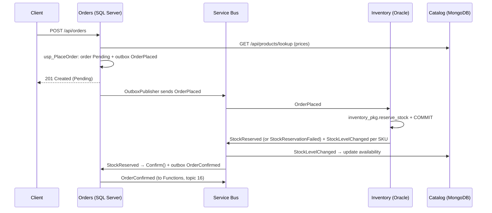

# 12 — SOA and microservices

> **Time:** 6 h · **Job requirement:** SOA / Microservices · **Builds on:** 09, 10, 11 · **Branch:** `feature/12-events-and-saga`

## Why it matters

Until now ShopFlow is three separate APIs with three separate databases. This topic connects them, and it's the topic that makes the project impressive in an interview: events on Azure Service Bus, the outbox pattern, idempotent consumers, a saga across SQL Server, Oracle and MongoDB, and resilient HTTP calls. You'll be able to answer *"How do you keep data consistent across microservices?"* with code you wrote.

---

## Learn

### Monolith, SOA, microservices

| | Monolith | SOA | Microservices |
| --- | --- | --- | --- |
| Deploy | One unit | Services, often through a central bus (ESB) | Each service on its own |
| Data | One database | Often shared | One database **per service** |
| Talk | In-process calls | ESB, SOAP/WCF, contracts | HTTP/gRPC + messages |
| Size | Whole app | Large business services | Small, one business capability |

**When not to use microservices:** a small team, an unclear domain, or no automation for deploying and monitoring many services. A well-structured **modular monolith** is often the better start. Saying this in an interview shows judgment.

### Sync vs async communication

| | Synchronous (HTTP, gRPC) | Asynchronous (messages) |
| --- | --- | --- |
| Caller waits | Yes | No |
| Coupling | Both services must be up | The receiver can be down; messages wait |
| Use for | Queries that need an answer now (prices) | Facts that happened (`OrderPlaced`) |
| Risk | Cascading failures | Eventual consistency, duplicates, ordering |

### Azure Service Bus concepts

| Concept | Meaning |
| --- | --- |
| Queue | One sender → one receiver group; each message processed once |
| Topic + subscriptions | Publish once; every subscription gets its own copy (publish/subscribe) |
| Filter / rule | A subscription only keeps messages matching a filter, e.g. `Subject = 'OrderPlaced'` |
| Peek-lock | The receiver locks a message, processes it, then **completes** it; if it crashes, the lock expires and the message comes back |
| Abandon | Give the message back now for a retry |
| Dead-letter queue (DLQ) | Where messages go after `MaxDeliveryCount` failures or when you dead-letter them on purpose (poison messages) |
| Duplicate detection | The broker drops a second message with the same `MessageId` within a time window (Standard tier and up) |
| Sessions | Ordered processing per key (e.g. per order) |

Delivery is **at-least-once**: a message can arrive more than once. Your consumers must be **idempotent**.

### Consistency patterns

- **Database per service + eventual consistency:** each service updates its own data, then tells others with an event. For a few seconds, data differs between services.
- **Saga:** a business process across services as a series of local transactions, each with a **compensating action** if a later step fails. *Choreography* = services react to each other's events (ShopFlow). *Orchestration* = a coordinator tells each service what to do (Durable Functions, MassTransit state machines).
- **Transactional outbox:** save the business change and the event in the **same local transaction** (an `OutboxMessages` table); a background publisher sends it later. Solves the "dual write" problem: saved to the database but crashed before publishing.
- **Inbox / idempotent consumer:** remember which `EventId`s you processed, or make the operation naturally safe to repeat.

### Resilience for HTTP calls

| Technique | What it does |
| --- | --- |
| Timeout | Don't wait forever |
| Retry with exponential backoff + jitter | Try again for transient errors, spreading retries out |
| Circuit breaker | After many failures, stop calling for a while and fail fast |
| Fallback / cache | Serve a cached answer when the dependency is down |
| Bulkhead | Limit concurrent calls so one slow dependency can't use all threads |

`Microsoft.Extensions.Http.Resilience` gives you all of it with `AddStandardResilienceHandler()`.

### Observability

Logs (what happened), metrics (how much, how fast), traces (the path of one request across services). A **correlation ID** links them. OpenTelemetry is the standard; in Azure it goes to Application Insights. The standalone **Aspire Dashboard** container is a free local viewer for traces.

---

## The saga you're building

---

## Build

### Part 1 — contracts and messaging building blocks

- [ ] ⭐ **`ShopFlow.Contracts`:** an abstract record `IntegrationEvent(Guid EventId, DateTime OccurredAt)` and one record per event in the main README's events table. These are the **public contract** between services: once published, add fields, but never rename or remove them.
  - The JSON your `usp_PlaceOrder` writes must deserialize into `OrderPlaced`. Check property names now.
- [ ] ⭐ **`ShopFlow.Messaging`** (references Contracts and `Azure.Messaging.ServiceBus`):

| Type | Responsibility |
| --- | --- |
| `IEventBus` | `PublishAsync<T>(T evt, ct) where T : IntegrationEvent`, plus `PublishRawAsync(string type, string json, Guid eventId, ct)` for the outbox |
| `ServiceBusEventBus` | Sends to topic `shopflow-events`: body = JSON, `Subject` = event type name, `MessageId` = `EventId`, `CorrelationId` = current correlation ID, `ContentType` = `application/json` |
| `IIntegrationEventHandler<T>` | `HandleAsync(T evt, ct)` |
| `ServiceBusSubscriber` (`BackgroundService`) | One `ServiceBusProcessor` for this service's subscription. Per message: read `Subject`, find the event type, deserialize, create a **DI scope**, run the handler, **complete**. Deserialization failure → **dead-letter**. Other exception → **abandon** (Service Bus retries, then dead-letters after `MaxDeliveryCount`) |
| `AddEventBus(...)` | Register `ServiceBusClient` (singleton), the bus, the subscriber for a subscription name, and handlers: `.AddHandler<OrderPlaced, OrderPlacedHandler>()` |

  - Hints: keep a dictionary `string → Type` of known events; `ServiceBusProcessorOptions { AutoCompleteMessages = false, MaxConcurrentCalls = … }`; open a logging scope with the message's `CorrelationId` and `MessageId`.

### Part 2 — run Service Bus locally

- [ ] ⭐ Run the **Azure Service Bus emulator** with Docker Compose. Follow the official instructions and compose file from the [emulator installer repository](https://github.com/Azure/azure-service-bus-emulator-installer) (it needs its own SQL container), and keep your configuration in `deploy/servicebus/Config.json`.
- [ ] ⭐ Write `Config.json` with one topic `shopflow-events` and four subscriptions, each with **correlation filter** rules on the message label (`Subject`):

| Subscription | Receives |
| --- | --- |
| `inventory-sub` | `OrderPlaced`, `OrderCancelled` |
| `orders-sub` | `StockReserved`, `StockReservationFailed` |
| `catalog-sub` | `StockLevelChanged` |
| `functions-sub` | `OrderConfirmed` |

  Set `MaxDeliveryCount` to 5 on each subscription.
- [ ] The emulator connection string uses `UseDevelopmentEmulator=true`. Put it in each service's user secrets as `ConnectionStrings:ServiceBus`.
- [ ] The emulator needs several GB of RAM. If your machine can't run it, create a real Service Bus namespace in Azure (**Standard** tier: topics aren't available in Basic), create the same topic and subscriptions in the portal, and delete it when you're done. Check the current price first.

### Part 3 — Orders: outbox publisher, real catalog client, saga handlers

- [ ] ⭐ **`OutboxPublisher` (`BackgroundService`)** in Orders.Infrastructure: every 2 seconds, create a scope, read up to 20 unprocessed messages (oldest first, `Attempts < 10`), publish each with `PublishRawAsync`, set `ProcessedAt`; on failure increase `Attempts` and save `LastError`. Use your filtered index from topic 02.
  - Think about it: with two instances of Orders running, both could publish the same row. Why is that acceptable here? (Bonus: read about `WITH (UPDLOCK, READPAST)` for claiming rows.)
- [ ] ⭐ **`CatalogClient : ICatalogClient`** — a typed `HttpClient` that calls `GET /api/products/lookup?skus=…` on Catalog (base URL from `CatalogOptions`), with `AddStandardResilienceHandler()`. Delete the fake catalog client.
- [ ] **`CachedCatalogClient`** — a **decorator** over `ICatalogClient` that caches each product for 30 seconds with `IMemoryCache`. Register it so the handler gets the decorator without knowing it.
- [ ] When Catalog is unreachable (after retries / with the circuit open), `PlaceOrder` returns a `Failure` with code `catalog.unavailable`, mapped to **503**.
- [ ] Add a `DelegatingHandler` that copies the current correlation ID into the `X-Correlation-ID` header of outgoing HTTP calls.
- [ ] ⭐ **Inbox:** add a `ProcessedMessages` table (`MessageId` PK, `Handler`, `ProcessedAt`) with a new EF migration.
- [ ] ⭐ **`StockReservedHandler`** → run `ConfirmOrderCommand`; **`StockReservationFailedHandler`** → run `RejectOrderCommand` with the reason. Both:
  - Return immediately if the `EventId` is already in `ProcessedMessages`.
  - Add the `ProcessedMessages` row to the **same** `DbContext` before running the command, so the command's `SaveChangesAsync` stores the order change, the outbox row and the inbox row in **one** transaction.
  - Treat "already confirmed / already rejected" as success, not an error.
- [ ] Cancelling an order now produces `OrderCancelled` through the domain event → interceptor → outbox path.
- [ ] ⭐ Delete the temporary `confirm` and `reject` endpoints from topic 08.

### Part 4 — Inventory: reserve on `OrderPlaced`, release on `OrderCancelled`

- [ ] ⭐ **`OrderPlacedHandler`:** call `ReserveAsync` (topic 10). Publish `StockReserved` if the status is `RESERVED` **or `ALREADY_RESERVED`**, otherwise `StockReservationFailed` with the message. Then publish one `StockLevelChanged` per SKU with the new available quantity.
  - Why also on `ALREADY_RESERVED`? If Inventory crashes **after** committing in Oracle but **before** publishing, Service Bus redelivers `OrderPlaced`. The package returns `ALREADY_RESERVED`, and you publish the result again. Orders' inbox ignores any duplicate. Write this reasoning in a comment: it's the heart of at-least-once delivery.
- [ ] **`OrderCancelledHandler`:** call `ReleaseAsync`; if lines were released, publish `StockLevelChanged` for those SKUs.
- [ ] Remove the manual `POST /api/reservations` endpoint (keep `DELETE` for support staff if you like, with the `Admin` role).

### Part 5 — Catalog: keep availability up to date

- [ ] ⭐ **`StockLevelChangedHandler`** → `UpdateAvailabilityAsync(sku, available, evt.OccurredAt)` from topic 10. Naturally idempotent: it **sets** a value and ignores older events.

### Part 6 — observability

- [ ] Add OpenTelemetry to `ShopFlow.ServiceDefaults`: tracing for ASP.NET Core, `HttpClient`, `SqlClient` and the Azure SDK, exported with OTLP.
- [ ] Run the standalone Aspire Dashboard container (`mcr.microsoft.com/dotnet/aspire-dashboard`) and find one order's trace across Orders → Catalog.
- [ ] Add a Service Bus health check to the three APIs.

---

## Check yourself

With the three databases, the Service Bus emulator and the three APIs running:

1. Place an order for available products → `201`, status `Pending`. Within a few seconds, `GET` it again → `Confirmed`; Oracle has `ACTIVE` reservations; Catalog shows lower `availability` for those SKUs; `OutboxMessages` has `OrderPlaced` and `OrderConfirmed` with `ProcessedAt` set.
2. Order `UPS-APC-1500` → ends `Rejected` with the reason from PL/SQL; Oracle's `reserved` is unchanged.
3. Cancel a confirmed order → `Cancelled`; Oracle reservations `RELEASED`; Catalog availability goes back up.
4. Stop Inventory, place an order → it stays `Pending`. Start Inventory → it gets confirmed (the message waited in the subscription).
5. Stop Catalog, place an order → `503 catalog.unavailable`, quickly once the circuit is open.
6. Publish the same `StockReserved` twice by hand (same `MessageId`) → the order is processed once.
7. Send a message with broken JSON to `orders-sub` → it lands in the dead-letter queue.

---

## Interview questions

1. Monolith vs SOA vs microservices? When would you **not** use microservices?
2. Sync vs async communication: when do you use each?
3. Queue vs topic with subscriptions?
4. What does at-least-once delivery mean for your code?
5. What is the transactional outbox, and what problem does it solve?
6. How do you make a consumer idempotent? Give two ways.
7. What is a saga? Choreography vs orchestration?
8. What is a dead-letter queue?
9. Timeout, retry, circuit breaker: what does each do?
10. How do you trace one request across several services?

Answers: [interview question bank](99-interview-questions.md#12--soa-and-microservices).

---

## Done when

- [ ] All seven checks above pass.
- [ ] No service reads another service's database.
- [ ] Pull request into `develop` merged.
